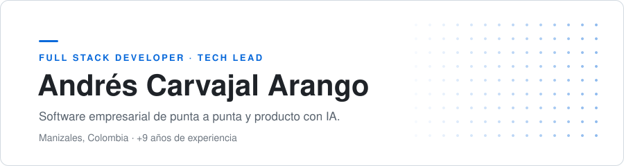

<picture>
  <source media="(prefers-color-scheme: dark)" srcset="assets/header-dark.svg" />
  <source media="(prefers-color-scheme: light)" srcset="assets/header-light.svg" />
  
</picture>

<a href="https://www.linkedin.com/in/andr%C3%A9s-carvajal-arango-b533a017a/">LinkedIn</a> &nbsp;·&nbsp; <a href="mailto:carvacerberus@gmail.com">Email</a> &nbsp;·&nbsp; <a href="https://mejor-dicho.com">mejor-dicho.com</a>

## Sobre mí

Soy desarrollador full stack con más de 9 años de experiencia construyendo software empresarial. Actualmente trabajo como Tech Lead: lidero un equipo de desarrollo y combino el trabajo técnico *hands-on* con la gestión de personas, proyectos y clientes.

Me gusta el trabajo de punta a punta, del modelo de datos a la experiencia de usuario. Uso la IA tanto en producto como en mi día a día de desarrollo, y en mis proyectos personales exploro cómo integrarla de forma útil.

## Experiencia

### Full Stack Developer & Tech Lead
Empresa de software empresarial · Manizales, Colombia

- Lidero un equipo de desarrollo, combinando ejecución técnica con gestión de personas y proyectos.
- Desarrollo full stack con ASP.NET (Web Forms), C#, SQL Server, Vue.js y JavaScript.
- Modernizo sistemas legacy, migrando formularios y lógica de cliente a frameworks actuales.
- Incorporo herramientas de IA (Claude Code) al flujo de desarrollo para automatizar tareas repetitivas.
- Lideré la migración del control de versiones del equipo de SVN a GitHub.
- Acompaño la relación con clientes y la planeación de proyectos con prácticas ágiles.
- Tengo experiencia en desarrollo móvil nativo con Java y Objective-C.

## Proyecto destacado

### [MejorDicho!](https://mejor-dicho.com)

Plataforma para preservar y compartir la cultura popular colombiana (dichos, refranes y piropos), organizada por los 33 departamentos del país. Es un proyecto personal que diseñé, desarrollé y desplegué de punta a punta.

- **Búsqueda semántica con IA** sobre el contenido, integrando la API de Claude.
- **Mapa interactivo** de Colombia para explorar los dichos por región.
- **Capa social** con reacciones, comentarios y ranking.
- **PWA instalable**, desplegada con Nginx + Gunicorn y CI/CD.

`Next.js 14` `FastAPI` `PostgreSQL` `Claude API` `Nginx`

## Habilidades

- Liderazgo técnico y gestión de equipos de desarrollo
- Gestión de proyectos y metodologías ágiles (Scrum)
- Modernización de sistemas legacy
- Integración de IA en producto y en el flujo de desarrollo
- Modelado de datos y SQL

## Stack

| Área | Tecnologías |
|---|---|
| **Lenguajes** | Python · TypeScript · JavaScript · C# · Java · SQL |
| **Frontend** | Next.js · React · Vue.js · Tailwind CSS |
| **Backend** | FastAPI · ASP.NET / .NET · Node.js |
| **Datos** | PostgreSQL · SQL Server |
| **IA** | Claude API · Claude Code · búsqueda semántica |
| **Infraestructura** | Docker · Nginx · Gunicorn · Linux · CI/CD |
| **Herramientas** | Git · GitHub |
